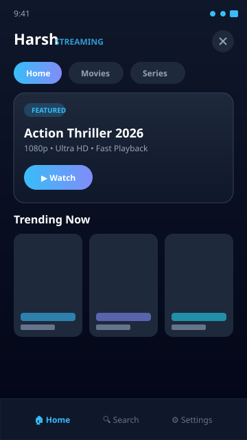
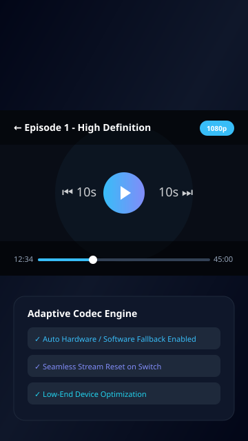
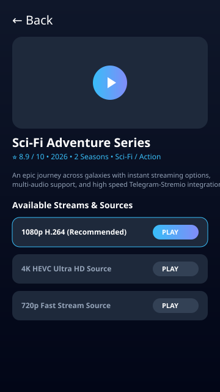

# Harsh - Premium Movies & Series Streaming

<p align="center">
  
</p>

<p align="center">
  <a href="https://github.com/Harsh5485/Harsh-app/releases"></a>
  &nbsp;
  <a href="https://github.com/Harsh5485/Harsh-app/archive/refs/heads/main.zip"></a>
</p>

---

## 📱 About The App

**Harsh** is a high-performance Android streaming application for movies and series. Built natively with Jetpack Compose and ExoPlayer, it features fast streaming and Telegram-Stremio source integration with smart codec fallback.

---

## 🚀 Key Features

- **⚡ Hardware & Software Fallback**: Automatically switches to software decoding for HEVC (H.265) / 4K videos if hardware acceleration fails on budget devices.
- **🔄 Complete State Reset**: Releases previous player instances and clears surface/codec state when switching streams (e.g. 4K to 1080p).
- **🛡️ Device Capability Detection**: Intelligently selects the most optimal stream (H.264 / 1080p) on lower-end devices to prevent player crashes.
- **📺 Telegram & Stremio Integration**: Access high-speed playback links across multiple sources.
- **🎨 Modern Material 3 UI**: Clean, responsive layout supporting phones and foldables.

---

## 📸 App Screenshots

<p align="center">
  
  &nbsp;&nbsp;
  
  &nbsp;&nbsp;
  
</p>

---

## 📥 Download Links

- 📦 **[Download APK (Releases)](https://github.com/Harsh5485/Harsh-app/releases)**
- 📁 **[Download Source Code (ZIP)](https://github.com/Harsh5485/Harsh-app/archive/refs/heads/main.zip)**

---

## ⚙️ How to generate the APK on GitHub Releases

Since your repository **`Harsh5485/Harsh-app`** currently has no published release:

1. **Option 1: Automatic Build via GitHub Actions**
   - Push this updated code from AI Studio to GitHub.
   - Go to the **Actions** tab in `https://github.com/Harsh5485/Harsh-app`.
   - The automated workflow (`.github/workflows/build-apk.yml`) will build `app-debug.apk` automatically and create the Release!

2. **Option 2: Create Release Manually**
   - Go to `https://github.com/Harsh5485/Harsh-app/releases`.
   - Click the green **"Create a new release"** button.
   - Tag version: `v1.0.0`
   - Release title: `Harsh App v1.0.0`
   - Attach the APK file (which you can generate from AI Studio top-right **Settings -> Generate APK** or from Android Studio `gradle assembleDebug`).
   - Click **Publish release**.

---

## 🛠️ Local Development

1. Clone the repository:
   ```bash
   git clone https://github.com/Harsh5485/Harsh-app.git
   cd Harsh-app
   ```
2. Open in **Android Studio**.
3. Build the APK locally using Gradle:
   ```bash
   gradle assembleDebug
   ```
   Output APK: `app/build/outputs/apk/debug/app-debug.apk`.

---

## 📄 License

This project is open-source and licensed under the [MIT License](LICENSE).
